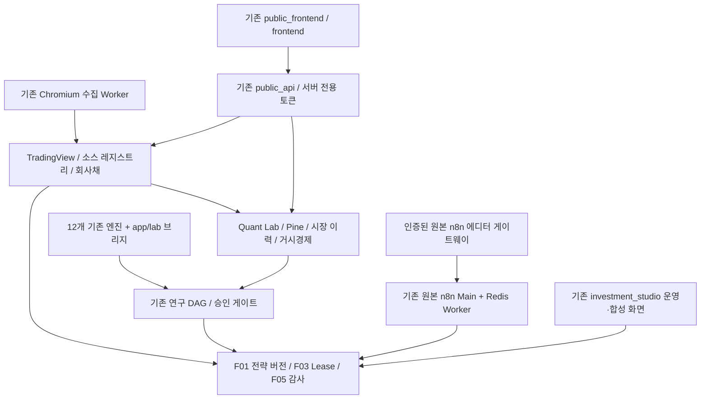

# 기존 시스템 통합 구조

기존 서비스를 한 저장소·통합 브랜치에서 개발한다. 운영 서비스들은 역할별 entrypoint와 DB를 유지한다. 신규 시스템이나 새 노드 에디터를 만들지 않는다.

| 역할 | Entry point / 경로 | 로컬 DB |
|---|---|---|
| 통합 API | app.main:app | 소스·Quant·Ops·DAG·시나리오 DB 분리 |
| TradingView | app.main_tradingview:app | AUTONOMOUS_DB_PATH |
| Quant Lab | app.main_quant_lab:app | QUANT_DB_PATH |
| 공개 중계 | public_api.main:app | 읽기 중계, 서버 토큰 사용 |
| 브라우저 Worker | browser_worker/main.py | 외부 출처 접근 전용 |

`/api/v1/alpha/scenarios`는 기존 합성 계약, `/api/v1/alpha/scenario-control`은 복원한 단계 콜백 계약이다. 후자는 n8n_scenarios의 별도 로컬 테스트 스택이며 운영 13개 워크플로를 덮어쓰지 않는다.

새로 연결한 소스·레지스트리·Quant API는 ALPHA_NODE_API_KEY로 보호한다. 서비스 별 entrypoint에서도 동일하다. 공개 프록시는 PUBLIC_TRADINGVIEW_TOKEN / PUBLIC_QUANT_TOKEN을 서버에서만 전달한다. Quant의 내부 호출은 TRADINGVIEW_SERVICE_TOKEN / INTEGRATED_SERVICE_TOKEN을 정확한 설정 origin에만 전달한다. Pine의 내부 소스 요청은 외부 Chromium을 거치지 않는다.

연구·훈련·실행 승인은 기존 runtime 정책을 유지한다. NautilusTrader 단일 주문 실행 계약을 보존하며 이번 통합에서 브로커를 연결하거나 실거래를 활성화하지 않았다. 전 엔진 독립 프로세스 기동/정지·자원 제한은 별도 미완료 항목이다.
